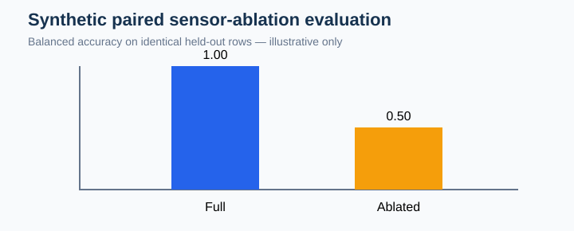
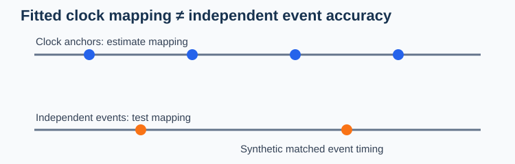

# From cleaner signals to scientifically better measurements

**Research implementation, 21 October 2026 — not a validated device benchmark or released API.**

The two experimental helpers under `research/october_2026/physiological_validation.py` distinguish measurement-level validity from participant-level inferential stability. The original illustration represents three deliberately separate estimands. None is interchangeable with the others.

## Reproducible example

~~~python
import numpy as np
import pandas as pd
from research.october_2026.physiological_validation import baseline_stability_audit, preprocessing_to_inference_audit

baseline = pd.DataFrame({
    "participant_id": ["P1"] * 8 + ["P2"] * 8,
    "time_s": list(range(8)) * 2,
    "value": list(np.linspace(1.0, 1.2, 8)) + [1.1] * 8,
})
print(baseline_stability_audit(baseline).to_string(index=False))
~~~

An observed baseline is not necessarily a stable baseline. Slopes, early/late changes and missingness describe the actual reference interval; no fixed stability cutoff is imposed.

## Participant-level difference plot

The following code draws an **original synthetic demonstration**, not empirical EDA outcomes:

~~~python
import matplotlib.pyplot as plt
participants = ["P1", "P2", "P3"]
raw_error = [0.50, 0.58, 0.46]
processed_error = [0.20, 0.30, 0.29]
fig, ax = plt.subplots(figsize=(6, 3))
for i, participant in enumerate(participants):
    ax.plot([0, 1], [raw_error[i], processed_error[i]], marker="o", label=participant)
ax.set_xticks([0, 1], ["Raw", "Processed"])
ax.set_ylabel("Synthetic waveform absolute error")
ax.legend(title="Independent unit")
fig.tight_layout()
~~~

The complete matched three-layer input requires signal reference, binary event labels on a common grid and separately estimated participant effects. Changes are bootstrapped by participant, not by time sample. Event-label error is not event-onset precision; scientific equivalence requires additional evidence.

## Qualification checklist

- Reproduce known-truth waveform and event recovery independently.
- Evaluate event onset and SCR amplitude with an expert reference set.
- Check bias, construct responsiveness and condition effects before and after preprocessing.
- Quantify participant-level uncertainty and negative outcomes.
- Validate stabilization procedures by modality; a cardiovascular protocol is not automatically an EDA or pupil standard.

**Status:** implementation and synthetic unit tests submitted for review; externally benchmarked clinical or scientific validity is not claimed.

## External classifier validation and sensor ablations

The complementary experimental module `research/october_2026/external_validation.py` checks explicit participant- and dataset-identity disjointness. It reports locked-threshold precision, recall, F1, balanced accuracy, average precision, external class prevalence, and whole-participant bootstrap intervals. It consumes supplied frozen predictions; it cannot prove that the model or threshold really was frozen.

~~~python
import pandas as pd
from research.october_2026.external_validation import (
    external_classifier_validation, modality_ablation_audit,
)
rows = pd.DataFrame({
    "participant_id": ["A", "A", "B", "B", "C", "C"],
    "dataset_id": ["external"] * 6,
    "outcome": [0, 1] * 3,
    "probability": [.1, .9] * 3,
    "full_probability": [.1, .9] * 3,
    "ablated_probability": [.1, .4] * 3,
})
external = external_classifier_validation(
    rows, training_participants=["development_subject"],
    training_datasets=["development"], locked_threshold=0.5,
)
ablation = modality_ablation_audit(rows)
print(external["metrics"], ablation["delta_balanced_accuracy"])
~~~

Both the external classifier and ablation checks are **descriptive research diagnostics**. A statistically meaningful between-modality difference requires prespecified endpoints, valid independent participant units, adequate sample size and external domain evidence. The example is synthetic and establishes no sensor complementarity.

## Clock synchronization versus event timing

The experimental `synchronization_validation.py` reports participant/session-specific affine or offset clock mapping from matched anchors **and separately** evaluates events that were not used as anchors. Low anchor residuals are not sufficient evidence of low event error.

~~~python
import pandas as pd
from research.october_2026.synchronization_validation import audit_clock_and_event_alignment
anchors = pd.DataFrame({
    "participant_id": ["P"]*4, "session_id":["S"]*4,
    "device_time_s":[1,2,3,4], "reference_time_s":[1.1,2.1,3.1,4.1],
})
events = pd.DataFrame({
    "participant_id":["P"]*2, "session_id":["S"]*2,
    "device_event_time_s":[1.5,3.5], "reference_event_time_s":[1.6,3.6],
})
audit = audit_clock_and_event_alignment(anchors, events, fit="affine")
print(audit["clock_fits"], audit["independent_event_errors"])
~~~

The illustration depicts synthetic clocks. Anchor/event independence must be verified from acquisition metadata in empirical use. Even a near-zero affine residual is not a hardware latency certificate.
